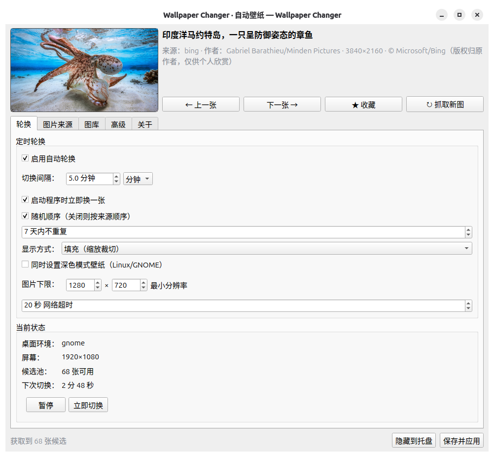

# Wallpaper Changer

跨平台**自动更换桌面壁纸**应用：Python + Qt（PySide6）开发，支持 **Ubuntu 26.04 / Linux** 与 **Windows**。
图片可来自 **Bing 每日壁纸**、**本地文件夹**或**自定义链接**（直链 / JSON 接口）；具备收藏、历史回溯、系统托盘常驻与开机自启动。

---

## 一、功能一览

| 能力 | 说明 |
| --- | --- |
| 图片来源 | Bing 每日图（官方 `HPImageArchive` 接口，免 Key）、本地文件夹（多目录、递归、自动读分辨率）、自定义链接（直链 / 本地路径 / JSON 接口） |
| 定时轮换 | 分钟/小时级间隔、随机或顺序、N 天内不重复、最小分辨率过滤、启动即换一张；**启动即开始倒计时**，每次换图成功后重新计时，勾选「启用自动轮换」即时生效 |
| 显示方式 | 填充 / 适应 / 拉伸 / 居中 / 平铺 / 跨屏延展（自动映射为各平台取值） |
| 收藏 | 一键收藏、收藏夹网格视图、可只轮换收藏、右键另存到本地 |
| 历史 | 完整应用记录、随时回到上一张、搜索与筛选、单条删除；启动时首页回显「当前壁纸」 |
| 托盘 | 托盘常驻、双击开界面、右键菜单直接换图/收藏/暂停/退出 |
| 开机启动 | Linux 写 `~/.config/autostart/*.desktop`（或可选 systemd --user）；Windows 写 `HKCU\...\Run` |
| 其他 | 单实例、失败/错误通知（成功静默）、Light/Dark 主题、HTTP 代理、缓存上限清理、日志 |

---

## 二、快速开始

### Linux（Ubuntu 26.04）

```bash
# 安装依赖（pip 与 apt 二选一，见下方说明）
python3 -m pip install --break-system-packages -r requirements.txt

python main.py                            # 启动界面
python main.py --minimized                # 只驻留托盘
python main.py --doctor                   # 环境自检（推荐先跑一次）
```

> 两种装法都行，选一种即可：
>
> - **pip（推荐，不依赖发行版仓库）**：`python3 -m pip install --break-system-packages -r requirements.txt`
>   （Ubuntu 23.04+ 因 PEP 668 需要 `--break-system-packages`；若提示 pip 不存在，先 `sudo apt install python3-pip`）
> - **apt（需启用 universe）**：`sudo add-apt-repository universe && sudo apt update && sudo apt install python3-pyside6.qtwidgets python3-pyside6.qtnetwork python3-requests python3-pil`
>
> apt 装的 PySide6 与 pip 装的互不可见：用 apt 装就统一走 apt，用 pip 装就统一走 pip，不要混用。
> 装完可用 `python3 main.py --doctor` 复核环境。

### Windows

```bat
pip install -r requirements.txt
python main.py
```

### 运行截图



---

## 三、目录结构

```
wallpaper-changer/
├── main.py                      桌面入口
├── wallpaper_changer/
│   ├── app.py                   应用核心：CLI、单实例、主题、日志
│   ├── config.py                配置模型与 JSON 持久化
│   ├── database.py              SQLite：图片库 / 收藏 / 历史
│   ├── engine.py                轮换引擎（Qt 信号 + 后台线程）
│   ├── fetcher.py               下载、缓存、缩略图、导出
│   ├── wallpaper.py             跨平台设置壁纸（Linux/Windows）
│   ├── autostart.py             开机自启动（XDG / systemd / 注册表）
│   ├── models.py                ImageRecord 数据模型
│   ├── sources/                 来源插件
│   │   ├── base.py              抽象基类（Session、代理、超时）
│   │   ├── bing.py              Bing 每日壁纸
│   │   ├── local.py             本地文件夹
│   │   └── custom_urls.py       自定义链接
│   └── ui/                      Qt 界面
│       ├── main_window.py       主窗口（6 个配置页）
│       ├── gallery.py           缩略图网格（收藏/历史）
│       ├── tray.py              系统托盘
│       └── icons.py             图标
├── packaging/
│   ├── linux/                   .desktop / build-deb.sh / build-appimage.sh / requirements-appimage.txt
│   └── windows/                 PyInstaller spec / build.bat / installer.iss
├── scripts/
│   ├── gen_assets.py            生成 icon.png / icon.ico
│   └── screenshot.py            离屏渲染主界面，生成文档截图
├── tests/                       单元测试与冒烟测试
└── assets/                      icon.png / icon.ico
```

---

## 四、打包分发

### 1) Debian / Ubuntu（.deb）

```bash
# 轻量包（约 77K，依赖系统已有的 Python + PySide6）
bash packaging/linux/build-deb.sh 1.0.1
sudo apt install ./dist/wallpaper-changer_1.0.1_all.deb

# 自包含包（约 59M，内置 PySide6 / requests / Pillow，不依赖系统 Qt 包）
bash packaging/linux/build-deb.sh 1.0.1 --bundle
sudo apt install ./dist/wallpaper-changer_1.0.1_all.deb
```

### 2) AppImage（免安装、跨发行版）

```bash
bash packaging/linux/build-appimage.sh 1.0.0          # 出 .AppImage
bash packaging/linux/build-appimage.sh 1.0.0 --dir-only # 只产出 AppDir，便于自查
chmod +x dist/Wallpaper-Changer-1.0.0-x86_64.AppImage
./dist/Wallpaper-Changer-1.0.0-x86_64.AppImage --show
```

AppImage 内自带 Python 标准库与依赖，不依赖目标机 Python 版本；构建机会自动下载 `appimagetool`（也可手动放到 `build/appimagetool`）。

### 3) Windows 安装器（Inno Setup）

```bat
packaging\windows\build.bat
```

流程：PyInstaller 打包 → `dist\Wallpaper Changer\` → 检测到 Inno Setup 时自动生成
`dist\WallpaperChanger-1.0.0-Setup.exe`。安装器提供**开机自启（最小化到托盘）**、开始菜单/桌面快捷方式、
卸载时清理运行中的进程与用户数据目录。未安装 Inno Setup 时会跳过安装器，仍可直接分发绿色目录。

> 依赖：`pip install -r requirements.txt pyinstaller`，安装器需 [Inno Setup 6](https://jrsoftware.org/isdl.php)。

---

## 五、配置说明

| 页签 | 关键项 |
| --- | --- |
| 轮换 | 开关、间隔（分钟/小时）、启动即换、随机顺序、N 天不重复、显示方式、最小分辨率、网络超时 |
| 图片来源 | Bing（区域市场、天数、UHD/1080p）、本地（目录列表、递归）、自定义 URL |
| 图库 | 收藏与历史合并为单一图库，顶栏可切换「历史 / 收藏 / 全部」；缩略图三档尺寸，**始终按原始宽高比完整显示、绝不裁切变形**；双击查看完整大图，右键菜单（设为壁纸/收藏/另存/打开原链接/删除），工具栏可一键重建缩略图 |
| 高级 | 开机自启、最小化启动、关闭到托盘、出错时通知、systemd 方式、缓存目录与上限、代理、主题、日志级别 |
| 维护 | 清空历史记录、恢复默认设置 |

配置文件位置：

- Linux：`~/.config/wallpaper-changer/config.json`
- Windows：`%APPDATA%\WallpaperChanger\config.json`
- 数据（壁纸缓存、缩略图、SQLite、日志）：`~/.local/share/wallpaper-changer/` 或 `%APPDATA%\WallpaperChanger\`

### 自定义链接的三种写法

```
https://example.com/a.jpg                          # 图片直链
/home/user/Pictures/a.png                          # 本地文件
json:https://example.com/api/wallpapers            # JSON 接口，自动提取图片链接
json:https://example.com/api/wallpapers#data.list  # 指定字段路径（点号分隔）
```

JSON 接口会自动识别 `url / image / src / download_url` 等字段以及嵌套的列表结构。

---

## 六、命令行用法

```bash
python main.py --show        # 呼出已运行实例的界面
python main.py --next        # 立即换一张
python main.py --prev        # 回到上一张
python main.py --refresh     # 重新抓取来源图池
python main.py --quit        # 退出运行中的实例
python main.py --minimized   # 启动后只驻留托盘
python main.py --log-level DEBUG
```

适合配合系统定时器或快捷键使用，例如 GNOME 自定义快捷键绑定 `python /path/main.py --next`。

---

## 七、桌面环境适配

| 环境 | 方式 |
| --- | --- |
| GNOME / Ubuntu（含 Wayland） | `gsettings` 设置 `picture-uri` 与 `picture-uri-dark` |
| KDE Plasma | `qdbus6/qdbus/dbus-send` 调用 PlasmaShell，或 `plasma-apply-wallpaperimage` |
| XFCE | `xfconf-query` 遍历所有 backdrop |
| MATE / Cinnamon / Deepin | 各自 gsettings schema |
| Sway / 其他 | `swaybg`；X11 下还可兜底 `feh` |
| Windows | `SystemParametersInfoW` + 注册表 `WallpaperStyle`（自动转 BMP） |

> 当前会话以 Wayland + GNOME 为主；若检测到环境不明，会按 GNOME → feh → swaybg 顺序尝试。

---

## 八、测试

```bash
python -m pytest tests -q        # 核心逻辑：配置、数据库、来源、缓存、Linux 命令拼装
python tests/test_ui_smoke.py    # 界面与引擎冒烟（offscreen，无需真实桌面）
```

核心测试 13 项，覆盖配置读写往返、数据库收藏/历史/去重/清理、本地目录扫描与分辨率读取、
尺寸过滤、缓存落盘与清理、自定义链接（含 JSON 接口解析）、Linux `gsettings` 命令拼装、缺失文件处理。

冒烟测试覆盖：本地来源抓取 → 候选池生成 → 切换与失败重试 → 收藏/历史 → 六个配置页切换 → 图标加载。

---

## 九、扩展新的图片来源

在 `wallpaper_changer/sources/` 新建模块，继承 `Source`：

```python
from .base import Source
from ..models import FetchResult, ImageRecord

class MySource(Source):
    name = "my"
    label = "我的图源"
    needs_network = True

    def fetch(self, limit: int = 30) -> FetchResult:
        res = FetchResult(source=self.name)
        # ... 请求接口，构造 ImageRecord(source=self.name, source_id=..., remote_url=...)
        return res
```

然后在 `sources/__init__.py` 的 `REGISTRY` 与 `build_sources()` 中注册，并在 `config.py` 增加对应设置段与界面控件即可。

---

## 十、许可与版权

代码可自由使用与修改。图片资源版权归各自作者所有，Bing 图片仅供个人欣赏、请勿用于商业用途。
使用本地图片或自定义链接时，请自行确认拥有相应授权。
